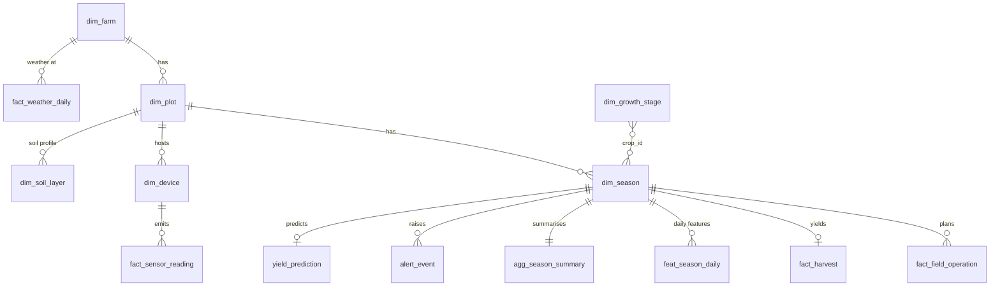

# Sesame Data Platform: Data Model

Status: November 2026. Landing, Bronze and Silver (batch and the sensor
stream) and the Gold water-balance tables are built. `alert_event` is next;
`yield_prediction` stays a design and is not built in the PoC.
Stack: RustFS object storage (S3 API), Apache Iceberg tables in a JDBC
catalog on Postgres, Apache Spark for both batch and Structured Streaming.
The architecture and flows are drawn in
[`architecture/sesame-platform.drawio`](architecture/sesame-platform.drawio).

## 1. Design principles

1. **The season is the central entity, not the plot.** A plot has many
   seasons. Sowing date, days after sowing (DAS), growth stage, fertiliser
   plan and yield all belong to a season.
2. **One grain per table.** Sensor readings are device × timestamp, weather
   is farm × date × source, features are season × date. Grains are never
   mixed in one table.
3. **Store time in UTC, aggregate by local date.** Timestamps are UTC
   (`ts`); daily tables use the local date in `Asia/Ho_Chi_Minh` (UTC+7).
   A UTC day would start at 07:00 in Vietnam and split the day/night cycle.
4. **Units live in column names** and are converted once, in Silver. Gold
   never guesses a unit.
5. **Bronze is append-only and keeps the raw payload**, so any Silver table
   can be rebuilt.
6. **One writer per table.** Every Iceberg table is written by Spark only,
   either a batch job or one Structured Streaming query, never both.

## 2. Conventions

### Identifiers

IDs nest farm → plot → season / device, so an ID shows where it belongs.
The mocks already generate them this way (`src/common/farm.py`).

The PoC has four demo farms (`DEMO_FARMS` in `src/common/farm.py`,
`BINHTHUAN_01` to `BINHTHUAN_04`), one plot and one Dong Xuan 2025 season
each. Every table already carries `farm_id` or an ID nested under it, so the
jobs need no change for more farms. NASA POWER weather is gridded (about
0.5° × 0.625°), so the farms are placed in different cells; farms in one cell
share their NASA weather and differ only through sensors and soil.

| Key | Rule | Example |
| --- | --- | --- |
| `farm_id` | Upper case, province + number | `BINHTHUAN_01` |
| `plot_id` | `<farm_id>_P<nn>` | `BINHTHUAN_01_P01` |
| `season_id` | `<plot_id>_<sowing year><season code>`; `DX` = Dong Xuan (sown Nov–Dec), `XH` = Xuan He (sown Feb–Mar), `KH` = outside both windows | `BINHTHUAN_01_P01_2026DX` |
| `device_id` | `SN_<plot_id>_<nn>` | `SN_BINHTHUAN_01_P01_01` |
| `operation_id` | `<season_id>_<op_type>_<DAS, 3 digits>` | `BINHTHUAN_01_P01_2026DX_fertilizer_015` |

Open question: the season year follows the sowing year. Confirm with the
grower whether they name a Dong Xuan season by its harvest year instead.

### Units and suffixes

| Suffix | Unit | Suffix | Unit |
| --- | --- | --- | --- |
| `_mm` | millimetres | `_pct` | percent |
| `_c` | degrees Celsius | `_kpa` | kilopascal |
| `_ds_m` | deciSiemens per metre | `_mj_m2` | MJ per m² per day |
| `_m_s` | metres per second | `_w_m2` | watts per m² |
| `_kg_ha` | kilograms per hectare | `_g_kg` | grams per kilogram |

### Time columns

| Column | Meaning |
| --- | --- |
| `ts` | Event time, `TIMESTAMP` in UTC |
| `date` | Local calendar date (UTC+7) for daily grains |
| `_ingested_at` | When the platform received the record (Bronze) |

## 3. Layers at a glance

| Layer | Storage | Written by | Content |
| --- | --- | --- | --- |
| Landing | RustFS bucket `landing-zone`, JSON | Python ingesters and mocks | Files exactly as the source returned them |
| Bronze | Iceberg tables, namespace `bronze` | Spark batch; Spark Structured Streaming for sensors | One table per source, append-only, raw payload + metadata |
| Silver | Iceberg tables, namespace `silver` | Spark batch; Spark Structured Streaming for sensor readings | Typed, deduplicated, unit-converted dimensions and facts |
| Gold | Iceberg tables, namespace `gold` | Spark batch | Season features, season summaries, alerts, predictions |

### Storage and table format

- **Object storage:** RustFS (Apache-2.0, S3-compatible) for development;
  Ceph RGW in production. Everything talks to it through the S3 API (boto3
  in Python, S3A in Spark), so swapping it changes configuration only.
- **Table format:** Apache Iceberg. Tables live in the Spark catalog
  `lakehouse`, so a full name is `lakehouse.<layer>.<table>`, e.g.
  `lakehouse.silver.fact_weather_daily`. Files sit under
  `s3a://lakehouse/warehouse/<layer>/<table>/`.
- **Catalog:** Iceberg JDBC catalog in the Postgres database
  `iceberg_catalog` (the same server as Airflow). A REST catalog is the
  production option.
- **Partitioning** (hidden partitioning, so queries filter on the column
  itself and never need a derived partition column):

| Table | Partition spec | Why |
| --- | --- | --- |
| `bronze.sensor_raw` | `days(kafka_ts)` | Arrival day; Bronze does not parse the payload |
| `silver.fact_sensor_reading` | `days(ts)` | Most queries read a day or a season of readings |
| `silver.fact_weather_daily`, `gold.feat_season_daily` | `months(date)` | One row per day; months keep files from being too small |
| `gold.alert_event` | `months(ts)` | Small, read by recent time |
| Dimensions, `fact_field_operation`, `fact_harvest`, `agg_season_summary` | none | Small tables, updated with `MERGE` |

- **Maintenance:** streaming writes many small files. A weekly Airflow job
  runs `rewrite_data_files`, `expire_snapshots` (keep 7 days) and
  `remove_orphan_files` on Bronze and Silver.
- **Time travel:** a model is trained on a fixed table snapshot
  (`VERSION AS OF <snapshot_id>`), recorded with the model, so results can be
  reproduced.

## 4. Entity relationships (Silver and Gold)

Sensor readings and weather do not carry `season_id`. They are assigned to a
season in Gold by joining on plot/farm and the season's date range
(`planting_date` to harvest date).

## 5. Landing zone

All paths are in the `landing-zone` bucket and use Hive-style partitions.

| Source | Script (`src/mock_iot/`) | Real or mock | Object key |
| --- | --- | --- | --- |
| Farm/plot/season/device config | `user_config_mock.py` | Mock | `user_config/farm_id=<farm>/config_<ts>.json` |
| Field operation plan | `user_config_mock.py` | Mock | `field_operation/farm_id=<farm>/season_id=<season>/plan_<ts>.json` |
| FAO crop parameters | `mock_fao_db.py` | Static | `fao_reference/crop=sesame/fao_56_33_params_<ts>.json` |
| Binh Thuan cultivation guide | `mock_fao_db.py` | Static | `agronomy_reference/crop=sesame/binh_thuan_black_2shell_<ts>.json` |
| NASA POWER daily weather | `nasa_ingest.py` | Real API | `nasa_power/farm_id=<farm>/ingest_dt=<date>/data_<start>_to_<end>_<hhmmss>Z.json` |
| OpenWeatherMap current weather | `owm_ingest.py` | Real API | `weather/farm_id=<farm>/dt=<date>/data_<ts>.json` |
| ISRIC SoilGrids | `isric_ingest.py` | Real API | `soilgrids/farm_id=<farm>/soilgrids_<ts>.json` |
| Field sensors | `producer.py` | Mock | Not in Landing: Kafka topic `sesame.sensor.raw` goes straight to Bronze |

## 6. Bronze

Every Bronze table has these metadata columns:

| Column | Type | Description |
| --- | --- | --- |
| `_source` | STRING | Source name, e.g. `nasa_power` |
| `_ingested_at` | TIMESTAMP | Time the row was written |
| `_file_path` | STRING | Landing object key (batch tables) |

| Table | Grain | Payload columns |
| --- | --- | --- |
| `bronze.sensor_raw` | Kafka message | `kafka_key`, `kafka_topic`, `kafka_partition`, `kafka_offset`, `kafka_ts`, `headers` (map, incl. `x-mock-fault`), `value` (raw JSON string), `_ingested_at` |
| `bronze.nasa_power_raw` | Landing file | `farm_id`, `ingest_dt`, `payload` (JSON string) |
| `bronze.owm_raw` | Landing file | `farm_id`, `dt`, `payload` |
| `bronze.soilgrids_raw` | Landing file | `farm_id`, `payload` |
| `bronze.user_config_raw` | Landing file | `farm_id`, `payload` |
| `bronze.field_operation_raw` | Landing file | `farm_id`, `season_id`, `payload` |
| `bronze.reference_raw` | Landing file | `crop`, `reference_type` (`fao`, `agronomy`), `payload` |

The batch tables are loaded by `src/jobs/landing_to_bronze.py`: one row per
landing file, partition values parsed from the object key, and files already
loaded (same `_file_path`) skipped, so re-runs add nothing twice. Every
ingester writes a new, timestamped file per run (a file overwritten under the
same key would not be reloaded), so Bronze keeps each version and Silver picks
the newest.

The sensor tables are written by `src/jobs/sensor_stream.py`, one long-running
Spark application (the `spark-streaming` service) with two Structured
Streaming queries, micro-batches every minute by default:

1. **Kafka → `bronze.sensor_raw`**: every message of `sesame.sensor.raw` as
   received, unreadable ones included, so they can be replayed. The Iceberg
   sink commits each micro-batch once, so a restart neither loses nor
   duplicates messages.
2. **`bronze.sensor_raw` → Silver**: reads the Bronze table as a stream; per
   micro-batch it parses and checks the messages (section 10), MERGEs valid
   readings into `fact_sensor_reading`, rejected ones into
   `quarantine_sensor`, and sends the unreadable ones (invalid JSON, missing
   required fields) to the DLQ topic `sesame.sensor.raw.dlq`.

Checkpoints (Kafka offsets, Bronze snapshots already read) live in the
`spark_checkpoints` volume of that service. Removing them alone would replay
the topic and append the messages to Bronze a second time (Silver would
absorb the replay); `infrastructure/scripts/reset_sensor_stream.sh` starts the
stream over cleanly instead (tables, checkpoints and topics together).

The stream runs with 4 shuffle partitions instead of Spark's 200: streaming
cannot coalesce them, and on one core 200 mostly empty tasks per step made a
full-season micro-batch take 35.8 s instead of 21.0 s (80,955 messages; 60 s
instead of 40 s for the whole catch-up run). Spark stores this setting in the
checkpoint, so it changes only for a stream started over.

## 7. Silver dimensions

The batch Silver tables are built by `src/jobs/bronze_to_silver.py
--source <bronze source>`: it parses every Bronze payload, keeps the row from
the newest landing file per primary key (latest `_ingested_at`, then
`_file_path`), runs the checks in section 10 and MERGEs into
`lakehouse.silver.<table>`. A row is only rewritten when a newer file supplies
it, so re-runs leave the data unchanged. Schemas, keys, checks and parsers
live in `src/lakehouse/silver.py`.

Every Silver table also carries two lineage columns: `_file_path` (the
landing file the row came from) and `_updated_at` (Silver write time).

| Bronze source | Silver tables |
| --- | --- |
| `user_config` | `dim_farm`, `dim_plot`, `dim_season`, `dim_device` |
| `reference` | `dim_growth_stage`, `dim_crop` |
| `soilgrids` | `dim_soil_layer` |
| `nasa_power` | `fact_weather_daily` (`source = 'nasa_power'`) |
| `field_operation` | `fact_field_operation` |

### `dim_farm`

| Column | Type | Description | Source |
| --- | --- | --- | --- |
| `farm_id` | STRING, PK | Farm identifier | config `farm.farm_id` |
| `province` | STRING | Province | config `farm.province` |
| `country` | STRING | ISO country code | config `farm.country` |
| `latitude` | DOUBLE | Farm centre | config `farm.latitude` |
| `longitude` | DOUBLE | Farm centre | config `farm.longitude` |
| `valid_from` | TIMESTAMP | Config version time | config `system_metadata.updated_at` |

### `dim_plot`

| Column | Type | Description | Source |
| --- | --- | --- | --- |
| `plot_id` | STRING, PK | Plot identifier | config `plot.plot_id` |
| `farm_id` | STRING, FK → `dim_farm` | Parent farm | config `plot.farm_id` |
| `geometry` | STRING (GeoJSON) | Plot polygon | config `plot.geometry` |
| `area_m2` | DOUBLE | Area from the polygon | config `plot.area_m2` |
| `perimeter_m` | DOUBLE | Perimeter from the polygon | config `plot.perimeter_m` |
| `soil_texture` | STRING | `sand`, `loamy_sand`, `sandy_loam`, `loam` | config `plot.soil_texture` |
| `drainage` | STRING | `good` or `poor` | config `plot.drainage` |

### `dim_season`

| Column | Type | Description | Source |
| --- | --- | --- | --- |
| `season_id` | STRING, PK | Season identifier | config `season.season_id` |
| `plot_id` | STRING, FK → `dim_plot` | Plot | config `season.plot_id` |
| `crop_id` | STRING | `sesame` | config `season.crop_id` |
| `variety` | STRING | Me den 2 vo Binh Thuan | config `season.variety` |
| `season_type` | STRING | `DX`, `XH`, `KH` | config `season.season_type` |
| `planting_date` | DATE | Sowing date (DAS 0) | config `season.planting_date` |
| `expected_harvest_date` | DATE | Planting date + season length | config |
| `actual_harvest_date` | DATE, nullable | Filled from the field log | config / `fact_field_operation` |
| `season_length_days` | INT | Currently 75 (assumption, confirm with grower) | config |
| `in_recommended_sowing_window` | BOOLEAN | Sown in Nov–Dec or Feb–Mar | config |
| `row_spacing_cm`, `hill_spacing_cm`, `plants_per_hill`, `seed_rate_kg_ha`, `irrigation_method` | various | Management plan | config `season.management` |
| `seed_lot_id`, `w1000_g`, `germination_pct`, `purity_pct`, `seed_moisture_pct` | various | Seed lot (inputs to the Seed Rate formula) | config `season.seed_lot` |

### `dim_device`

| Column | Type | Description | Source |
| --- | --- | --- | --- |
| `device_id` | STRING, PK | Sensor node | config `devices[].device_id` |
| `plot_id` | STRING, FK → `dim_plot` | Plot | config `devices[].plot_id` |
| `device_type` | STRING | `libelium_smart_agriculture_xtreme` | config |
| `soil_probe_depth_cm` | INT | Soil probe depth (15 cm) | config |
| `installed_date` | DATE | Installation date | config |

### `dim_growth_stage`

One row per crop and FAO stage; built from `fao_reference`.

| Column | Type | Description |
| --- | --- | --- |
| `crop_id` | STRING, PK | `sesame` |
| `stage` | STRING, PK | `initial`, `development`, `mid_season`, `late_season` |
| `stage_order` | INT | 1 to 4 |
| `das_start`, `das_end` | INT | Stage window in days after sowing, `das_start` ≤ DAS < `das_end` (15/25/25/10 split of 75 days) |
| `kc_start`, `kc_end` | DOUBLE | Crop coefficient at stage start and end (0.35 → 1.10 → 0.25) |

### `dim_crop`

One row per crop; the constants of the FAO reference the Gold water balance
needs, so a revised reference changes Gold without a code change.

| Column | Type | Description |
| --- | --- | --- |
| `crop_id` | STRING, PK | `sesame` |
| `crop_name` | STRING | Display name |
| `season_length_days` | INT | Sum of the stage lengths (75) |
| `kc_ini`, `kc_mid`, `kc_end` | DOUBLE | FAO-56 crop coefficients |
| `max_root_depth_low_m`, `max_root_depth_high_m` | DOUBLE | FAO-56 range of maximum rooting depth (1.0–1.5 m) |
| `depletion_fraction_p` | DOUBLE | Share of TAW the crop uses before stress (0.6) |
| `max_crop_height_m` | DOUBLE | 1.0 |

### `dim_soil_layer`

| Column | Type | Description | Source |
| --- | --- | --- | --- |
| `farm_id` | STRING | Farm (SoilGrids is queried at the farm point) | ingest partition |
| `plot_id` | STRING, nullable | Set when a lab test exists for the plot | lab data |
| `depth` | STRING | `0-5cm`, `5-15cm`, `15-30cm`, `30-60cm` | SoilGrids |
| `top_cm`, `bottom_cm` | INT | Layer bounds, to weight layers over the root zone | SoilGrids `range` |
| `sand_pct`, `clay_pct`, `silt_pct` | DOUBLE | Texture | SoilGrids g/kg ÷ 10 |
| `ph` | DOUBLE | pH in water | SoilGrids `phh2o` ÷ 10 |
| `soc_g_kg` | DOUBLE | Soil organic carbon | SoilGrids `soc` ÷ `d_factor` |
| `nitrogen_g_kg` | DOUBLE | Total nitrogen (not plant-available N) | SoilGrids `nitrogen` ÷ `d_factor` |
| `bulk_density_g_cm3` | DOUBLE | Bulk density | SoilGrids `bdod` ÷ 100 |
| `cec_cmol_kg` | DOUBLE | Cation exchange capacity | SoilGrids `cec` ÷ `d_factor` |
| `source` | STRING | `soilgrids` or `lab` | |
| `is_mock` | BOOLEAN | Written by `mock_api_responses` instead of the API | payload `mock` |

Read conversion factors from the response's `d_factor`; do not hard-code them.

## 8. Silver facts

### `fact_sensor_reading`

Grain: `device_id` × `ts`. Built from `bronze.sensor_raw`; on a duplicate
key the first message (lowest Kafka offset) wins and later ones are dropped,
also across micro-batches; late messages keep their own `ts`.

| Column | Type | Message field |
| --- | --- | --- |
| `device_id` | STRING, FK → `dim_device` | `device_id` |
| `farm_id` | STRING | `farm_id` (for regional aggregates) |
| `plot_id` | STRING | `plot_id` |
| `ts` | TIMESTAMP (UTC) | `timestamp` (epoch seconds) |
| `sample_interval_s` | INT | `sample_interval_s` |
| `vwc_pct` | DOUBLE | `measurements.soil.vwc_pct` |
| `soil_temp_c` | DOUBLE | `measurements.soil.temp_c` |
| `bulk_ec_ds_m` | DOUBLE | `measurements.soil.bulk_ec_ds_m` |
| `water_potential_kpa` | DOUBLE | `measurements.soil.water_potential_kpa` (negative) |
| `soil_oxygen_pct` | DOUBLE | `measurements.soil.oxygen_level_pct` |
| `leaf_wetness_min` | DOUBLE | `measurements.canopy.leaf_wetness_min` |
| `canopy_temp_c` | DOUBLE | `measurements.canopy.surface_temp_c` |
| `air_temp_c` | DOUBLE | `measurements.weather_micro.ambient_temp_c` |
| `rh_pct` | DOUBLE | `measurements.weather_micro.humidity_pct` |
| `rain_mm` | DOUBLE | `measurements.weather_micro.rain_mm` (per interval) |
| `wind_m_s` | DOUBLE | `measurements.weather_micro.wind_speed_m_s` |
| `solar_w_m2` | DOUBLE | `measurements.weather_micro.solar_rad_w_m2` |
| `battery_pct` | DOUBLE | `telemetry.battery_pct` |
| `rssi_dbm` | INT | `telemetry.rssi_dbm` |
| `irrigation_active` | BOOLEAN | `flags.irrigation_active` |
| `irrigation_mm` | DOUBLE | `measurements.irrigation.applied_mm` (flow meter, depth applied in the interval) |
| `kafka_partition`, `kafka_offset` | INT, BIGINT | Bronze lineage |
| `_updated_at` | TIMESTAMP | Silver write time |

### `fact_weather_daily`

Grain: `farm_id` × `date` × `source`. Several sources sit side by side so
they can be compared; NASA POWER is the proposed main input for ET0.

| Column | Type | NASA POWER | OpenWeatherMap | Sensors |
| --- | --- | --- | --- | --- |
| `farm_id` | STRING | partition | partition | via `dim_device` → `dim_plot` |
| `date` | DATE (local) | response date | snapshot date | readings aggregated per day |
| `source` | STRING | `nasa_power` | `owm` | `sensor` |
| `tmin_c`, `tmax_c` | DOUBLE | `T2M_MIN`, `T2M_MAX` | min/max of snapshots | min/max of `air_temp_c` |
| `tmean_c` | DOUBLE | `T2M` | mean `main.temp` | mean `air_temp_c` |
| `rh_pct` | DOUBLE | `RH2M` | mean `main.humidity` | mean `rh_pct` |
| `wind_2m_m_s` | DOUBLE | `WS2M` | `wind.speed` × 0.748 (10 m → 2 m) | mean `wind_m_s` |
| `rs_mj_m2` | DOUBLE | `ALLSKY_SFC_SW_DWN` (check unit: MJ/m²/day with `community=ag`) | not available | Σ `solar_w_m2` × interval ÷ 10⁶ |
| `precip_mm` | DOUBLE | `PRECTOTCORR` | `rain.1h` sums | Σ `rain_mm` |

| `is_mock` | BOOLEAN | payload `mock` | – | – |

NASA POWER marks missing values with `-999` (`header.fill_value`); these
become NULL, and a day with no value at all is dropped so it cannot replace
a complete row from an older file. Radiation is converted to MJ/m²/day from
the unit in the response (`kW-hr/m^2/day` × 3.6); an unknown unit fails the job.

Built so far: NASA POWER only. OpenWeatherMap stays in Bronze, because the
daily DAG takes one current-weather snapshot a day, which is not a daily
minimum, maximum or rainfall total. Sensor rows come with the stream (Day 3).

### `fact_field_operation`

Grain: `operation_id`. Planned rows come from the season plan; the same row
is updated to `done` when the field log arrives.

| Column | Type | Description |
| --- | --- | --- |
| `operation_id` | STRING, PK | See ID conventions |
| `season_id` | STRING, FK → `dim_season` | Season |
| `plot_id` | STRING | Plot |
| `op_type` | STRING | `sowing`, `fertilizer`, `weed_control`, `irrigation`, `spraying`, `harvest` |
| `das` | INT | Planned day after sowing |
| `planned_date` | DATE | `planting_date` + `das` |
| `actual_date` | DATE, nullable | From the field log |
| `status` | STRING | `planned` or `done` |
| `details` | STRING (JSON) | e.g. `products_kg_ha` for fertiliser |

Irrigation is not planned ahead. Until a real log exists, irrigation comes
from the sensors (`fact_sensor_reading.irrigation_mm`) and reaches Gold as
`feat_season_daily.irrigation_mm`.

### `fact_harvest`

Grain: `season_id`. No source yet; it needs the grower's records.

| Column | Type | Description |
| --- | --- | --- |
| `season_id` | STRING, PK/FK | Season |
| `harvest_date` | DATE | Harvest date |
| `yield_kg_ha` | DOUBLE | Grain yield |
| `grain_moisture_pct` | DOUBLE | Moisture at sale (standard ≤ 7 %) |
| `impurity_pct` | DOUBLE | Impurities (standard ≤ 1 %) |

### `quarantine_sensor`

Messages that fail parsing or data-quality checks.

| Column | Type | Description |
| --- | --- | --- |
| `kafka_partition`, `kafka_offset` | INT, BIGINT | Key back to Bronze (primary key) |
| `device_id`, `ts` | STRING, TIMESTAMP | When readable |
| `raw_value` | STRING | Original message |
| `dq_rule` | STRING | First rule that failed |
| `dq_detail` | STRING | Offending value or error |
| `mock_fault` | STRING | `x-mock-fault` header of an injected fault (NULL for real data), to measure what the checks catch |
| `quarantined_at` | TIMESTAMP | When it was quarantined |

## 9. Gold

Built by `src/jobs/silver_to_gold.py` (task `gold_build`, last in both DAGs).
Each run recomputes the Gold tables from Silver and replaces their content in
one Iceberg commit; older versions stay reachable as snapshots. The checks of
section 10 run before each write.

### `feat_season_daily`

Grain: `season_id` × `date`, from `planting_date` to the harvest date (actual
when logged, else expected). A daily root-zone water balance, FAO-56 chapter 8
with the single crop coefficient (`src/lakehouse/gold.py`):

- **ET0**: Penman-Monteith (`common.et0`) from the NASA POWER row of
  `fact_weather_daily`, farm latitude from `dim_farm`, elevation 50 m.
- **Kc, stage**: interpolated by DAS from `dim_growth_stage`.
- **Root depth Zr**: 0.20 m at sowing, growing linearly to
  `dim_crop.max_root_depth_low_m` (1.0 m, the low end for sandy soil and a
  75-day season) at the start of mid-season.
- **TAW** = 1000 (θFC − θWP) Zr with θ from the plot's `soil_texture`
  (`common.soil`, FAO-56 table 19); **RAW** = p · TAW (`dim_crop`).
- **Ks** = 1 while depletion ≤ RAW, then (TAW − Dr) / ((1 − p) TAW), from the
  depletion at the start of the day.
- **Depletion** Dr = Dr(yesterday) − effective rain − irrigation + ETa, kept
  between 0 and TAW; water above field capacity drains (`deep_percolation_mm`).
  The root zone starts at field capacity on the sowing day.
- **Rain**: the plot's own gauges (sensor rain, averaged over its devices)
  when at least 80 % of the expected readings arrived that day, else NASA
  POWER. Rain below 0.2 · ET0 is not effective (it evaporates from the surface).
- Sensor values are grouped by local day (`Asia/Ho_Chi_Minh`); a reading
  belongs to the day its interval starts.

| Column | Type | Description |
| --- | --- | --- |
| `season_id`, `date` | STRING, DATE | Key |
| `farm_id`, `plot_id` | STRING | For maps and regional views |
| `das` | INT | Days after sowing |
| `stage`, `kc` | STRING, DOUBLE | From `dim_growth_stage` |
| `root_depth_m` | DOUBLE | Zr |
| `et0_mm` | DOUBLE | Reference ET |
| `etc_mm` | DOUBLE | Crop water need, Kc · ET0 |
| `ks` | DOUBLE | Water-stress coefficient (0–1) |
| `eta_mm` | DOUBLE | Actual ET, Ks · ETc |
| `precip_mm`, `rain_source` | DOUBLE, STRING | Rain used in the balance and where it came from (`sensor`, `nasa_power`) |
| `nasa_precip_mm`, `sensor_rain_mm` | DOUBLE | Both rain values, for comparison |
| `effective_precip_mm` | DOUBLE | Rain counted in the balance |
| `irrigation_mm`, `irrigation_hours` | DOUBLE | From the sensors' flow meters |
| `taw_mm`, `raw_mm` | DOUBLE | Total and readily available water |
| `depletion_mm`, `depletion_pct_taw` | DOUBLE | Root-zone depletion at the end of the day |
| `deep_percolation_mm` | DOUBLE | Water drained below the root zone |
| `tmin_c`, `tmax_c` | DOUBLE | NASA POWER |
| `gdd`, `gdd_cum` | DOUBLE | Growing degree days, base 10 °C, and their season total |
| `vwc_mean_pct`, `vwc_min_pct`, `vwc_max_pct` | DOUBLE | Plot sensors |
| `soil_oxygen_min_pct` | DOUBLE | Lowest soil O₂ |
| `leaf_wet_hours` | DOUBLE | Hours with wet leaves |
| `sensor_coverage_pct` | DOUBLE | Readings received / expected |
| `water_stress_flag` | BOOLEAN | `ks` < 1 |
| `heat_stress_flag` | BOOLEAN | `tmax_c` ≥ 35 °C |
| `waterlog_flag` | BOOLEAN | `soil_oxygen_min_pct` < 10 % |
| `weather_complete` | BOOLEAN | The day had every input of ET0 |

The 35 °C, 10 % O₂, 10 °C base, 0.20 m and 50 m values are assumptions (the
grower's guide gives none); they are constants in `src/lakehouse/gold.py`.

### `agg_season_summary`

Grain: `season_id`. Season totals from `feat_season_daily`; later also the
training table for yield models, once `fact_harvest` exists.

| Column | Type | Description |
| --- | --- | --- |
| `season_id` | STRING, PK | Season |
| `farm_id`, `plot_id`, `planting_date`, `harvest_date` | | Season context |
| `status` | STRING | `completed` when every day had weather, else `in_progress` |
| `days`, `days_weather_complete` | INT | Days in the balance |
| `precip_total_mm`, `effective_precip_total_mm`, `irrigation_total_mm` | DOUBLE | Water in |
| `irrigation_events` | INT | Days with irrigation |
| `etc_total_mm`, `eta_total_mm`, `eta_etc_ratio` | DOUBLE | Crop need, use and their ratio (input of the FAO-33 yield response) |
| `deep_percolation_total_mm` | DOUBLE | Water lost below the roots |
| `water_stress_days`, `stress_days_flowering` | INT | Days with `ks` < 1, overall and in mid-season (flowering) |
| `waterlog_days`, `heat_stress_days` | INT | Days with those flags |
| `rain_mm_harvest_window` | DOUBLE | NASA rain from harvest to 8 days after (bundles standing, sun drying) |
| `gdd_total` | DOUBLE | Season GDD |
| `vwc_mean_pct`, `sensor_coverage_pct` | DOUBLE | Sensor averages |

### `agg_region_daily`

Grain: `province` × `date`. How the farms of a province are doing on a day.

| Column | Type | Description |
| --- | --- | --- |
| `province`, `date` | STRING, DATE | Key |
| `farms_active`, `seasons_active` | INT | Farms and seasons in the field that day |
| `farms_water_stress`, `farms_waterlogged`, `farms_heat_stress` | INT | Farms with the flag |
| `avg_depletion_pct_taw`, `max_depletion_pct_taw` | DOUBLE | Root-zone depletion across farms |
| `avg_et0_mm`, `avg_precip_mm`, `max_precip_mm` | DOUBLE | Weather across farms |
| `avg_vwc_mean_pct` | DOUBLE | Soil moisture across farms |

### `alert_event`

Grain: `season_id` × `ts` × `rule`.

| Column | Type | Description |
| --- | --- | --- |
| `season_id`, `ts`, `rule` | STRING, TIMESTAMP, STRING | Key |
| `severity` | STRING | `info`, `warning`, `critical` |
| `value`, `threshold` | DOUBLE | Measured value and the limit it crossed |
| `message` | STRING | Text sent to Slack and the dashboard |
| `acknowledged` | BOOLEAN | Set by the user |

Rules come from the grower's cultivation guide: waterlogging (high VWC or
low soil O₂), drought at flowering (`ks` < 1 in `mid_season`), heavy rain at
flowering or in the harvest window, and fertiliser or weeding due from
`planned` operations.

### `yield_prediction`

Grain: `season_id` × `predicted_at`.

| Column | Type | Description |
| --- | --- | --- |
| `season_id`, `predicted_at` | STRING, TIMESTAMP | Key |
| `model` | STRING | `fao33_baseline` or an ML model version |
| `yield_kg_ha` | DOUBLE | Predicted yield |
| `yield_low_kg_ha`, `yield_high_kg_ha` | DOUBLE | Prediction interval |

The FAO-33 baseline is Ya/Ym = 1 − Ky (1 − ETa/ETc); an ML model replaces it
once `fact_harvest` covers several seasons. Not built in the PoC: the platform
monitors the growing regions; `agg_season_summary` already holds ETa/ETc and
the stress counts such a model would use.

## 10. Data quality checks

Implemented for the batch Silver tables in `src/lakehouse/quality.py` (plain
Spark counts; Great Expectations can replace it later). Every table checks
that its primary key is not NULL and unique, every rule below, and that each
foreign key value exists in the referenced table. An error-level failure
stops the job before the table is written, so the Airflow task fails; a
warning is only printed in the task log.

| Table | Error checks | Warnings |
| --- | --- | --- |
| `dim_farm` | latitude/longitude in range | |
| `dim_plot` | `area_m2` > 0; known `soil_texture` and `drainage`; `farm_id` in `dim_farm` | |
| `dim_season` | `planting_date` set; `expected_harvest_date` > `planting_date`; `plot_id` in `dim_plot` | sown outside Nov–Dec / Feb–Mar; `germination_pct` < 70; `purity_pct` < 99 |
| `dim_device` | `plot_id` in `dim_plot` | |
| `dim_growth_stage` | `das_end` > `das_start`; Kc between 0 and 2 | |
| `dim_soil_layer` | pH 3–10; sand/clay/silt 0–100 %; `farm_id` in `dim_farm` | sand + clay + silt not within 100 ± 3 %; bulk density outside 0.5–2.2 |
| `fact_weather_daily` | `tmin_c` ≤ `tmax_c`; `precip_mm`, `rs_mj_m2`, `wind_2m_m_s` ≥ 0; `rh_pct` 0–100 | temperature outside −10 to 50 °C |
| `fact_field_operation` | known `status` and `op_type`; `actual_date` set when `status = done`; `season_id` in `dim_season` | |

Sensor messages (`src/lakehouse/sensor.py`, checked in this order; a message
is quarantined under the first rule it breaks, and a missing value breaks
the rule):

| Rule | Sent to the DLQ topic |
| --- | --- |
| `valid_json` | yes |
| `required_fields`: `device_id`, `timestamp`, `soil`, `canopy`, `weather_micro` present | yes |
| `vwc_pct` 0–60; `rh_pct` 0–100; `air_temp_c` 5–50; `water_potential_kpa` ≤ 0 (0 in saturated soil); `battery_pct` 0–100 | no |
| `device_id` exists in `dim_device` (skipped until `dim_device` exists) | no |
| No duplicate (`device_id`, `ts`): later duplicates are dropped, not quarantined | no |

Gold tables (`src/lakehouse/gold.py`; also primary key and `season_id` in
`dim_season`):

| Table | Error checks | Warnings |
| --- | --- | --- |
| `feat_season_daily` | DAS ≥ 0; Kc 0–2; Ks 0–1; ET0 0–15 mm; ETa ≤ ETc; depletion between 0 and TAW | a day without complete weather |
| `agg_season_summary` | totals ≥ 0; ETa/ETc 0–1; known status | |
| `agg_region_daily` | flagged farms ≤ active farms | |

Planned for the next layers:

| Layer / table | Checks |
| --- | --- |
| `fact_weather_daily` | NASA rows not older than 10 days (freshness, for the daily DAG) |
| `fact_harvest` | `grain_moisture_pct` ≤ 7; `impurity_pct` ≤ 1 |

Failed sensor records go to `quarantine_sensor`; failed batch checks stop
the Airflow DAG (a Slack alert is planned).

## 11. Decisions

### Taken

| Decision | Choice | Reason |
| --- | --- | --- |
| Streaming engine | Spark Structured Streaming (no Flink) | About one reading per device every 15 minutes and alerts measured in minutes; one engine for batch, streaming and ML. Kafka in front lets Flink be added later as another consumer |
| Table format | Apache Iceberg | Engine-neutral (Spark, Trino, DuckDB), hidden partitioning, partition evolution, safe commits through a catalog |
| Catalog | Iceberg JDBC catalog on Postgres | No extra service for the PoC; REST catalog in production |
| Object storage | RustFS (dev), Ceph RGW (prod) | MinIO stopped shipping free images; both speak the S3 API |
| Sensor path | Kafka → Spark Structured Streaming → Bronze | No Kafka Connect S3 sink and no Landing step for sensors |
| Irrigation control | Rules on the field gateway, not in the cloud | A valve must react even when the network is down |

### Open

1. **Main weather source for ET0.** Proposed: NASA POWER, with sensors and
   OpenWeatherMap for comparison.
2. **Keep OpenWeatherMap?** The current endpoint only returns a snapshot; a
   forecast needs One Call 3.0.
3. **Season naming.** Sowing year (current) or harvest year.
4. **Season length and stage split.** 75 days with a 15/25/25/10 split is an
   assumption until the grower confirms it.
