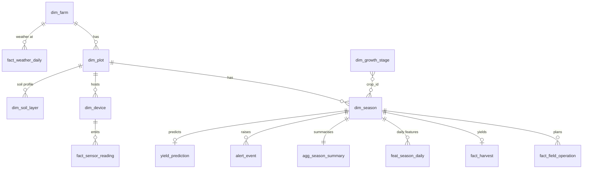

# Sesame Data Platform: Data Model

Status: proposal, October 2026. The landing layer exists (mock and API
ingesters); Bronze, Silver and Gold are designed here but not yet built.
The architecture and flows are drawn in
[`architecture/sesame-platform.drawio`](architecture/sesame-platform.drawio).

## 1. Design principles

1. **The season is the central entity, not the plot.** A plot has many
   seasons. Sowing date, days after sowing (DAS), growth stage, fertiliser
   plan and yield all belong to a season.
2. **One grain per table.** Sensor readings are device × timestamp, weather
   is farm × date × source, features are season × date. Grains are never
   mixed in one table.
3. **Store time in UTC, aggregate by local date.** Timestamps are UTC
   (`ts`); daily tables use the local date in `Asia/Ho_Chi_Minh` (UTC+7).
   A UTC day would start at 07:00 in Vietnam and split the day/night cycle.
4. **Units live in column names** and are converted once, in Silver. Gold
   never guesses a unit.
5. **Bronze is append-only and keeps the raw payload**, so any Silver table
   can be rebuilt.

## 2. Conventions

### Identifiers

IDs nest farm → plot → season / device, so an ID shows where it belongs.
The mocks already generate them this way (`src/common/farm.py`).

| Key | Rule | Example |
| --- | --- | --- |
| `farm_id` | Upper case, province + number | `BINHTHUAN_01` |
| `plot_id` | `<farm_id>_P<nn>` | `BINHTHUAN_01_P01` |
| `season_id` | `<plot_id>_<sowing year><season code>`; `DX` = Dong Xuan (sown Nov–Dec), `XH` = Xuan He (sown Feb–Mar), `KH` = outside both windows | `BINHTHUAN_01_P01_2026DX` |
| `device_id` | `SN_<plot_id>_<nn>` | `SN_BINHTHUAN_01_P01_01` |
| `operation_id` | `<season_id>_<op_type>_<DAS, 3 digits>` | `BINHTHUAN_01_P01_2026DX_fertilizer_015` |

Open question: the season year follows the sowing year. Confirm with the
grower whether they name a Dong Xuan season by its harvest year instead.

### Units and suffixes

| Suffix | Unit | Suffix | Unit |
| --- | --- | --- | --- |
| `_mm` | millimetres | `_pct` | percent |
| `_c` | degrees Celsius | `_kpa` | kilopascal |
| `_ds_m` | deciSiemens per metre | `_mj_m2` | MJ per m² per day |
| `_m_s` | metres per second | `_w_m2` | watts per m² |
| `_kg_ha` | kilograms per hectare | `_g_kg` | grams per kilogram |

### Time columns

| Column | Meaning |
| --- | --- |
| `ts` | Event time, `TIMESTAMP` in UTC |
| `date` | Local calendar date (UTC+7) for daily grains |
| `_ingested_at` | When the platform received the record (Bronze) |

## 3. Layers at a glance

| Layer | Storage | Written by | Content |
| --- | --- | --- | --- |
| Landing | MinIO bucket `landing-zone`, JSON | Python ingesters and mocks | Files exactly as the source returned them |
| Bronze | Delta tables | Spark (batch and streaming) | One table per source, append-only, raw payload + metadata |
| Silver | Delta tables | Spark batch | Typed, deduplicated, unit-converted dimensions and facts |
| Gold | Delta tables | Spark batch | Season features, season summaries, alerts, predictions |

## 4. Entity relationships (Silver and Gold)

Sensor readings and weather do not carry `season_id`. They are assigned to a
season in Gold by joining on plot/farm and the season's date range
(`planting_date` to harvest date).

## 5. Landing zone

All paths are in the `landing-zone` bucket and use Hive-style partitions.

| Source | Script (`src/mock_iot/`) | Real or mock | Object key |
| --- | --- | --- | --- |
| Farm/plot/season/device config | `user_config_mock.py` | Mock | `user_config/farm_id=<farm>/config_<ts>.json` |
| Field operation plan | `user_config_mock.py` | Mock | `field_operation/farm_id=<farm>/season_id=<season>/plan_<ts>.json` |
| FAO crop parameters | `mock_fao_db.py` | Static | `fao_reference/crop=sesame/fao_56_33_params.json` |
| Binh Thuan cultivation guide | `mock_fao_db.py` | Static | `agronomy_reference/crop=sesame/binh_thuan_black_2shell.json` |
| NASA POWER daily weather | `nasa_ingest.py` | Real API | `nasa_power/farm_id=<farm>/ingest_dt=<date>/data_<start>_to_<end>_<hhmmss>Z.json` |
| OpenWeatherMap current weather | `owm_ingest.py` | Real API | `weather/farm_id=<farm>/dt=<date>/data_<ts>.json` |
| ISRIC SoilGrids | `isric_ingest.py` | Real API | `soilgrids/farm_id=<farm>/soilgrids.json` |
| Field sensors | `producer.py` | Mock | Not in Landing: Kafka topic `sesame.sensor.raw` goes straight to Bronze |

## 6. Bronze

Every Bronze table has these metadata columns:

| Column | Type | Description |
| --- | --- | --- |
| `_source` | STRING | Source name, e.g. `nasa_power` |
| `_ingested_at` | TIMESTAMP | Time the row was written |
| `_file_path` | STRING | Landing object key (batch tables) |

| Table | Grain | Payload columns |
| --- | --- | --- |
| `bronze.sensor_raw` | Kafka message | `kafka_key`, `kafka_partition`, `kafka_offset`, `kafka_ts`, `headers` (incl. `x-mock-fault`), `value` (raw JSON string) |
| `bronze.nasa_power_raw` | Landing file | `farm_id`, `payload` (JSON string) |
| `bronze.owm_raw` | Landing file | `farm_id`, `payload` |
| `bronze.soilgrids_raw` | Landing file | `farm_id`, `payload` |
| `bronze.user_config_raw` | Landing file | `farm_id`, `payload` |
| `bronze.field_operation_raw` | Landing file | `farm_id`, `season_id`, `payload` |
| `bronze.reference_raw` | Landing file | `reference_type` (`fao`, `agronomy`), `crop_id`, `payload` |

`bronze.sensor_raw` keeps messages that cannot be parsed, so they can be
replayed and sent to the DLQ topic `sesame.sensor.raw.dlq`.

## 7. Silver dimensions

### `dim_farm`

| Column | Type | Description | Source |
| --- | --- | --- | --- |
| `farm_id` | STRING, PK | Farm identifier | config `farm.farm_id` |
| `province` | STRING | Province | config `farm.province` |
| `country` | STRING | ISO country code | config `farm.country` |
| `latitude` | DOUBLE | Farm centre | config `farm.latitude` |
| `longitude` | DOUBLE | Farm centre | config `farm.longitude` |
| `valid_from` | TIMESTAMP | Config version time | config `system_metadata.updated_at` |

### `dim_plot`

| Column | Type | Description | Source |
| --- | --- | --- | --- |
| `plot_id` | STRING, PK | Plot identifier | config `plot.plot_id` |
| `farm_id` | STRING, FK → `dim_farm` | Parent farm | config `plot.farm_id` |
| `geometry` | STRING (GeoJSON) | Plot polygon | config `plot.geometry` |
| `area_m2` | DOUBLE | Area from the polygon | config `plot.area_m2` |
| `perimeter_m` | DOUBLE | Perimeter from the polygon | config `plot.perimeter_m` |
| `soil_texture` | STRING | `sand`, `loamy_sand`, `sandy_loam`, `loam` | config `plot.soil_texture` |
| `drainage` | STRING | `good` or `poor` | config `plot.drainage` |

### `dim_season`

| Column | Type | Description | Source |
| --- | --- | --- | --- |
| `season_id` | STRING, PK | Season identifier | config `season.season_id` |
| `plot_id` | STRING, FK → `dim_plot` | Plot | config `season.plot_id` |
| `crop_id` | STRING | `sesame` | config `season.crop_id` |
| `variety` | STRING | Me den 2 vo Binh Thuan | config `season.variety` |
| `season_type` | STRING | `DX`, `XH`, `KH` | config `season.season_type` |
| `planting_date` | DATE | Sowing date (DAS 0) | config `season.planting_date` |
| `expected_harvest_date` | DATE | Planting date + season length | config |
| `actual_harvest_date` | DATE, nullable | Filled from the field log | config / `fact_field_operation` |
| `season_length_days` | INT | Currently 75 (assumption, confirm with grower) | config |
| `in_recommended_sowing_window` | BOOLEAN | Sown in Nov–Dec or Feb–Mar | config |
| `row_spacing_cm`, `hill_spacing_cm`, `plants_per_hill`, `seed_rate_kg_ha`, `irrigation_method` | various | Management plan | config `season.management` |
| `seed_lot_id`, `w1000_g`, `germination_pct`, `purity_pct`, `seed_moisture_pct` | various | Seed lot (inputs to the Seed Rate formula) | config `season.seed_lot` |

### `dim_device`

| Column | Type | Description | Source |
| --- | --- | --- | --- |
| `device_id` | STRING, PK | Sensor node | config `devices[].device_id` |
| `plot_id` | STRING, FK → `dim_plot` | Plot | config `devices[].plot_id` |
| `device_type` | STRING | `libelium_smart_agriculture_xtreme` | config |
| `soil_probe_depth_cm` | INT | Soil probe depth (15 cm) | config |
| `installed_date` | DATE | Installation date | config |

### `dim_growth_stage`

One row per crop and FAO stage; built from `fao_reference`.

| Column | Type | Description |
| --- | --- | --- |
| `crop_id` | STRING, PK | `sesame` |
| `stage` | STRING, PK | `initial`, `development`, `mid_season`, `late_season` |
| `das_start`, `das_end` | INT | Stage window in days after sowing (15/25/25/10 split of 75 days) |
| `kc_start`, `kc_end` | DOUBLE | Crop coefficient at stage start and end (0.35 → 1.10 → 0.25) |

### `dim_soil_layer`

| Column | Type | Description | Source |
| --- | --- | --- | --- |
| `farm_id` | STRING | Farm (SoilGrids is queried at the farm point) | ingest partition |
| `plot_id` | STRING, nullable | Set when a lab test exists for the plot | lab data |
| `depth` | STRING | `0-5cm`, `5-15cm`, `15-30cm`, `30-60cm` | SoilGrids |
| `sand_pct`, `clay_pct`, `silt_pct` | DOUBLE | Texture | SoilGrids g/kg ÷ 10 |
| `ph` | DOUBLE | pH in water | SoilGrids `phh2o` ÷ 10 |
| `soc_g_kg` | DOUBLE | Soil organic carbon | SoilGrids `soc` ÷ `d_factor` |
| `nitrogen_g_kg` | DOUBLE | Total nitrogen (not plant-available N) | SoilGrids `nitrogen` ÷ `d_factor` |
| `bulk_density_g_cm3` | DOUBLE | Bulk density | SoilGrids `bdod` ÷ 100 |
| `cec_cmol_kg` | DOUBLE | Cation exchange capacity | SoilGrids `cec` ÷ `d_factor` |
| `source` | STRING | `soilgrids` or `lab` | |

Read conversion factors from the response's `d_factor`; do not hard-code them.

## 8. Silver facts

### `fact_sensor_reading`

Grain: `device_id` × `ts`. Built from `bronze.sensor_raw`; duplicates on
the key are dropped, late messages keep their own `ts`.

| Column | Type | Message field |
| --- | --- | --- |
| `device_id` | STRING, FK → `dim_device` | `device_id` |
| `plot_id` | STRING | `plot_id` |
| `ts` | TIMESTAMP (UTC) | `timestamp` (epoch seconds) |
| `sample_interval_s` | INT | `sample_interval_s` |
| `vwc_pct` | DOUBLE | `measurements.soil.vwc_pct` |
| `soil_temp_c` | DOUBLE | `measurements.soil.temp_c` |
| `bulk_ec_ds_m` | DOUBLE | `measurements.soil.bulk_ec_ds_m` |
| `water_potential_kpa` | DOUBLE | `measurements.soil.water_potential_kpa` (negative) |
| `soil_oxygen_pct` | DOUBLE | `measurements.soil.oxygen_level_pct` |
| `leaf_wetness_min` | DOUBLE | `measurements.canopy.leaf_wetness_min` |
| `canopy_temp_c` | DOUBLE | `measurements.canopy.surface_temp_c` |
| `air_temp_c` | DOUBLE | `measurements.weather_micro.ambient_temp_c` |
| `rh_pct` | DOUBLE | `measurements.weather_micro.humidity_pct` |
| `rain_mm` | DOUBLE | `measurements.weather_micro.rain_mm` (per interval) |
| `wind_m_s` | DOUBLE | `measurements.weather_micro.wind_speed_m_s` |
| `solar_w_m2` | DOUBLE | `measurements.weather_micro.solar_rad_w_m2` |
| `battery_pct` | DOUBLE | `telemetry.battery_pct` |
| `rssi_dbm` | INT | `telemetry.rssi_dbm` |
| `irrigation_active` | BOOLEAN | `flags.irrigation_active` |
| `kafka_offset` | BIGINT | Bronze lineage |

### `fact_weather_daily`

Grain: `farm_id` × `date` × `source`. Several sources sit side by side so
they can be compared; NASA POWER is the proposed main input for ET0.

| Column | Type | NASA POWER | OpenWeatherMap | Sensors |
| --- | --- | --- | --- | --- |
| `farm_id` | STRING | partition | partition | via `dim_device` → `dim_plot` |
| `date` | DATE (local) | response date | snapshot date | readings aggregated per day |
| `source` | STRING | `nasa_power` | `owm` | `sensor` |
| `tmin_c`, `tmax_c` | DOUBLE | `T2M_MIN`, `T2M_MAX` | min/max of snapshots | min/max of `air_temp_c` |
| `rh_pct` | DOUBLE | `RH2M` | mean `main.humidity` | mean `rh_pct` |
| `wind_2m_m_s` | DOUBLE | `WS2M` | `wind.speed` × 0.748 (10 m → 2 m) | mean `wind_m_s` |
| `rs_mj_m2` | DOUBLE | `ALLSKY_SFC_SW_DWN` (check unit: MJ/m²/day with `community=ag`) | not available | Σ `solar_w_m2` × interval ÷ 10⁶ |
| `precip_mm` | DOUBLE | `PRECTOTCORR` | `rain.1h` sums | Σ `rain_mm` |

NASA POWER marks missing values with `-999`; these become NULL.

### `fact_field_operation`

Grain: `operation_id`. Planned rows come from the season plan; the same row
is updated to `done` when the field log arrives.

| Column | Type | Description |
| --- | --- | --- |
| `operation_id` | STRING, PK | See ID conventions |
| `season_id` | STRING, FK → `dim_season` | Season |
| `plot_id` | STRING | Plot |
| `op_type` | STRING | `sowing`, `fertilizer`, `weed_control`, `irrigation`, `spraying`, `harvest` |
| `das` | INT | Planned day after sowing |
| `planned_date` | DATE | `planting_date` + `das` |
| `actual_date` | DATE, nullable | From the field log |
| `status` | STRING | `planned` or `done` |
| `details` | STRING (JSON) | e.g. `products_kg_ha` for fertiliser |

Irrigation is not planned ahead. `done` irrigation rows can be derived from
`fact_sensor_reading.irrigation_active` until a real log exists.

### `fact_harvest`

Grain: `season_id`. No source yet; it needs the grower's records.

| Column | Type | Description |
| --- | --- | --- |
| `season_id` | STRING, PK/FK | Season |
| `harvest_date` | DATE | Harvest date |
| `yield_kg_ha` | DOUBLE | Grain yield |
| `grain_moisture_pct` | DOUBLE | Moisture at sale (standard ≤ 7 %) |
| `impurity_pct` | DOUBLE | Impurities (standard ≤ 1 %) |

### `quarantine_sensor`

Messages that fail parsing or data-quality checks.

| Column | Type | Description |
| --- | --- | --- |
| `kafka_partition`, `kafka_offset` | INT, BIGINT | Key back to Bronze |
| `raw_value` | STRING | Original message |
| `dq_rule` | STRING | Rule that failed |
| `dq_detail` | STRING | Offending value or error |
| `quarantined_at` | TIMESTAMP | When it was quarantined |

## 9. Gold

### `feat_season_daily`

Grain: `season_id` × `date`, from `planting_date` to the harvest date.

| Column | Type | Description |
| --- | --- | --- |
| `season_id`, `date` | STRING, DATE | Key |
| `das` | INT | Days after sowing |
| `stage` | STRING | From `dim_growth_stage` |
| `kc` | DOUBLE | Kc interpolated by DAS |
| `et0_mm` | DOUBLE | FAO-56 Penman-Monteith from `fact_weather_daily` |
| `etc_mm` | DOUBLE | `et0_mm` × `kc` × `ks` |
| `precip_mm` | DOUBLE | Daily rain |
| `effective_precip_mm` | DOUBLE | Rain the crop can use |
| `irrigation_mm` | DOUBLE | Applied irrigation |
| `vwc_mean_pct`, `vwc_min_pct` | DOUBLE | Plot sensor aggregates |
| `depletion_mm` | DOUBLE | Root-zone depletion (water balance) |
| `ks` | DOUBLE | Water-stress coefficient (0–1) |
| `gdd` | DOUBLE | Growing degree days |
| `leaf_wet_hours` | DOUBLE | Hours with wet leaves |
| `soil_oxygen_min_pct` | DOUBLE | Lowest soil O₂ |
| `heat_stress_flag`, `waterlog_flag` | BOOLEAN | Daily stress flags |

The ET0, Kc and soil water functions already exist in `src/common/`
(`et0.py`, `crop.py`, `soil.py`).

### `agg_season_summary`

Grain: `season_id`. The training table for yield models.

| Column | Type | Description |
| --- | --- | --- |
| `season_id` | STRING, PK | Season |
| `precip_total_mm`, `irrigation_total_mm`, `etc_total_mm` | DOUBLE | Season totals |
| `stress_days_flowering` | INT | Days with `ks` < 1 during flowering |
| `waterlog_days` | INT | Days with `waterlog_flag` |
| `rain_mm_harvest_window` | DOUBLE | Rain from harvest to the end of drying |
| `gdd_total` | DOUBLE | Season GDD |
| `yield_kg_ha` | DOUBLE, nullable | From `fact_harvest` |
| `wue_kg_m3` | DOUBLE, nullable | Water use efficiency |

`wue_kg_m3` contains the yield, so it is a post-season KPI only and must not
be used as a feature to predict the same season's yield.

### `alert_event`

Grain: `season_id` × `ts` × `rule`.

| Column | Type | Description |
| --- | --- | --- |
| `season_id`, `ts`, `rule` | STRING, TIMESTAMP, STRING | Key |
| `severity` | STRING | `info`, `warning`, `critical` |
| `value`, `threshold` | DOUBLE | Measured value and the limit it crossed |
| `message` | STRING | Text sent to Slack and the dashboard |
| `acknowledged` | BOOLEAN | Set by the user |

Rules come from the grower's cultivation guide: waterlogging (high VWC or
low soil O₂), drought at flowering (`ks` < 1 in `mid_season`), heavy rain at
flowering or in the harvest window, and fertiliser or weeding due from
`planned` operations.

### `yield_prediction`

Grain: `season_id` × `predicted_at`.

| Column | Type | Description |
| --- | --- | --- |
| `season_id`, `predicted_at` | STRING, TIMESTAMP | Key |
| `model` | STRING | `fao33_baseline` or an ML model version |
| `yield_kg_ha` | DOUBLE | Predicted yield |
| `yield_low_kg_ha`, `yield_high_kg_ha` | DOUBLE | Prediction interval |

The FAO-33 baseline is Ya/Ym = 1 − Ky (1 − ETa/ETc); an ML model replaces it
once `fact_harvest` covers several seasons.

## 10. Data quality checks

| Layer / table | Checks (Great Expectations) |
| --- | --- |
| `bronze.sensor_raw` → `fact_sensor_reading` | Valid JSON and schema; `vwc_pct` 0–60; `rh_pct` 0–100; `air_temp_c` 5–50; `water_potential_kpa` < 0; no duplicate (`device_id`, `ts`); `device_id` exists in `dim_device` |
| `fact_weather_daily` | `tmin_c` ≤ `tmax_c`; `precip_mm` ≥ 0; NASA rows not older than 10 days (freshness) |
| `dim_season` | `planting_date` in a sowing window (warning only); `germination_pct` ≥ 70; `purity_pct` ≥ 99 |
| `fact_field_operation` | Unique `operation_id`; `actual_date` set when `status = done` |
| `fact_harvest` | `grain_moisture_pct` ≤ 7; `impurity_pct` ≤ 1 |

Failed sensor records go to `quarantine_sensor`; failed batch checks stop
the Airflow DAG and alert Slack.

## 11. Open decisions

1. **Main weather source for ET0.** Proposed: NASA POWER, with sensors and
   OpenWeatherMap for comparison.
2. **Keep OpenWeatherMap?** The current endpoint only returns a snapshot; a
   forecast needs One Call 3.0.
3. **Sensor path into the lakehouse.** Proposed: Spark Structured Streaming
   from Kafka straight to Bronze, instead of a Kafka Connect S3 sink into
   Landing.
4. **Season naming.** Sowing year (current) or harvest year.
5. **Season length and stage split.** 75 days with a 15/25/25/10 split is an
   assumption until the grower confirms it.
